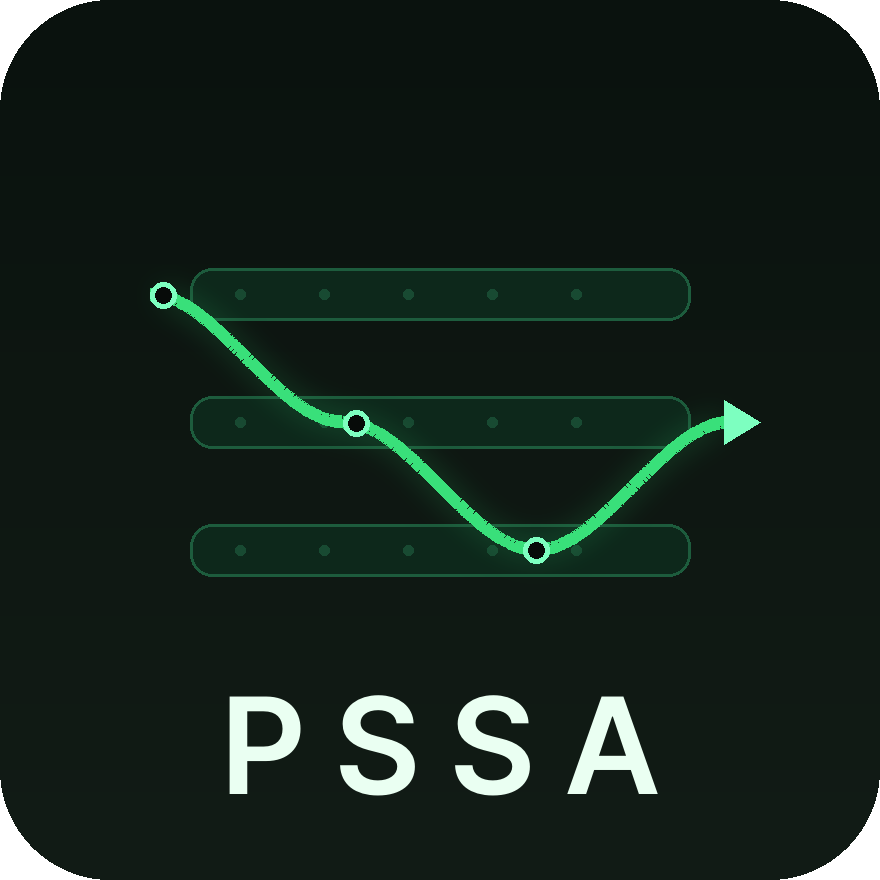
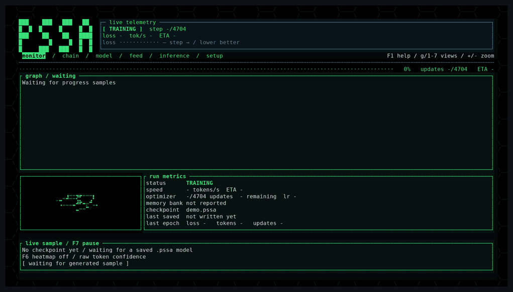
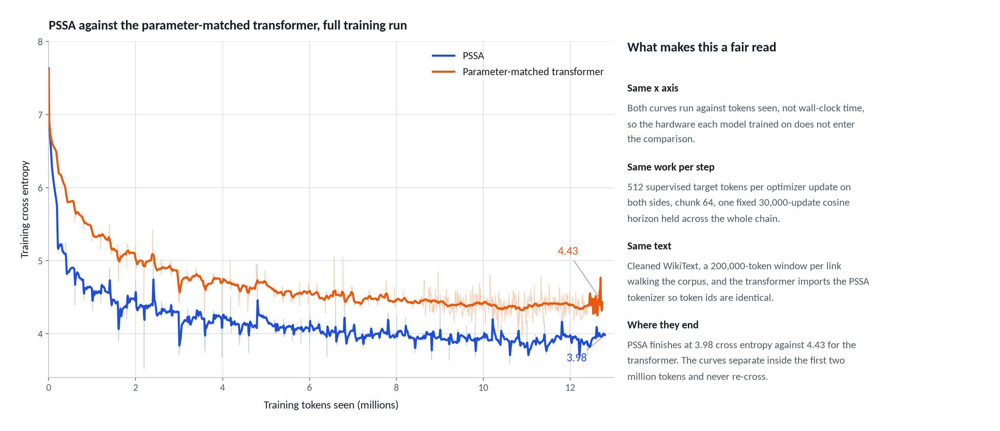

<p align="center">
  
</p>

# PSSA: a plastic state-space architecture

[](https://discord.gg/9sqfKeqWYF)

PSSA is a small language model that is not a transformer. It reads text one
token at a time through a recurrent state-space layer, keeps a bank of episodic
memories it can look things up in, and rewrites part of its own weights while it
runs. It is written in Rust from scratch, with no PyTorch, no TensorFlow, and no
ML framework of any kind underneath it.

At matched parameters and on the same corpus, it learns faster than a
transformer and generates text about twelve times quicker on the same CPU.



## Headline result

Two models, same corpus, same tokenizer, same optimizer schedule, same seed,
same number of parameters. One is PSSA, one is a standard transformer. Over
12.7M tokens of cleaned WikiText-103, PSSA finished at **3.98** training
cross-entropy against **4.43**: a gap of **0.45 nats**, perplexity 53.7 against
83.7.



The gap holds on text neither model has seen: on a 198,939-token held-out slice,
PSSA scores **3.997** cross-entropy against **4.429** (perplexity 54.4 against
83.8, next-token accuracy 24.1% against 18.0%). On matched CPU hardware PSSA also
trains at 1,716 tokens/second against 415 (4.1x), and generates 200 tokens in
226 ms against 2,735 ms (12x).

These are 1.5M-parameter models on 12.7M tokens: a research prototype, not a
competitor to anything you have heard of. The full curves, the matched-run
methodology, the caveats and the reproduction scripts are in
[docs/benchmarks.md](docs/benchmarks.md).

## What makes it different

- **A recurrent state-space core.** Learned continuous state matrices carry
  information forward in a fixed-size state, instead of attention over the full
  context window.
- **An episodic memory bank.** 512 slots with hyperbolic (Poincare-style)
  retrieval, written to and read from during the run.
- **Plastic weights.** Fast updates reinforce what works, novelty drives growth,
  and a refractory gate rate-limits overwrites.
- **Closed-form consolidation.** A ridge-regression step folds the fast plastic
  updates back into the base transition matrix.
- **No framework.** Hand-written linear algebra in Rust, with a CUDA path for
  training and a scalar CPU reference that every gradient is checked against
  (max gradient difference 2.98e-8).

The layer, the write path and the training pipeline are described in
[docs/architecture.md](docs/architecture.md).

## Quick start

```bash
git clone https://github.com/Sparticle62ops/pssa.git
cd pssa
cargo install --path .                    # CPU build
cargo install --path . --features cuda    # NVIDIA GPU build (cuBLAS)
pssa
```

Running it with no arguments opens the dashboard. Everything the dashboard does
is also a plain CLI command, so it works the same over SSH, in a notebook
terminal, or in a script. Requirements, backends, datasets, Hugging Face caches
and long-corpus training chains are covered in [docs/setup.md](docs/setup.md).

## Documentation

- [docs/setup.md](docs/setup.md) — install, build, backends, dataset and cache
  setup, WikiText cleaning, long-corpus chains, checkpoint compatibility.
- [docs/architecture.md](docs/architecture.md) — the recurrence, hyperbolic
  memory read, gate/adapter/MLP, plastic write path and training pipeline.
- [docs/benchmarks.md](docs/benchmarks.md) — headline results, matched-run
  methodology, throughput caveats, benchmark and comparison commands.
- [docs/cli.md](docs/cli.md) — commands, options, chat, plain logs and
  generation defaults.
- [docs/tui.md](docs/tui.md) — the terminal dashboard: monitor, inference,
  setup, model/chain/feed, backups, run controls, library and evaluation.
- [docs/experiments.md](docs/experiments.md) — dreaming, the loss guard, memory
  capacity experiments and the boxes-world world model.
- [docs/contributors.md](docs/contributors.md) — building and testing locally,
  commit and PR expectations, code layout, roadmap and where help is needed.

Deeper write-ups for specific features and experiments:

- [docs/training-setup.md](docs/training-setup.md) — the TUI training wizard.
- [docs/TUI-EXTRAS.md](docs/TUI-EXTRAS.md) — Kaggle launch/monitor, plastic
  memory inspector, A/B inference, runs browser, alerts and GIF recording.
- [docs/COMPARISON.md](docs/COMPARISON.md) — replaying a chain against the
  transformer and scoring held-out tokens.
- [docs/TRANSFORMER-BASELINE.md](docs/TRANSFORMER-BASELINE.md) — the
  parameter-matched decoder-only baseline.
- [docs/GPU-CLIP-SPEED.md](docs/GPU-CLIP-SPEED.md) — gradient clipping and the
  memory-value cap.
- [docs/PAIRED-EVAL.md](docs/PAIRED-EVAL.md) — the paired multi-seed evaluation
  harness.
- [docs/BATCHING.md](docs/BATCHING.md) — independent-sequence batching.
- [docs/STACKED-DEPTH.md](docs/STACKED-DEPTH.md) — stacked-depth PSSA and loops.
- [docs/distill_trainer.md](docs/distill_trainer.md) — Qwen3-to-PSSA
  distillation trainer design.
- [docs/tui-demo.tape](docs/tui-demo.tape) — the VHS tape that records the
  dashboard GIF.
- [assets/math.md](assets/math.md) — equations and source references for the
  layer, also rendered by the dashboard's `F11` math tab.

## What this is not

- These are **1.5M-parameter models** on 12.7M tokens. That is a research
  prototype, not a competitor to anything you have heard of.
- Text quality at this scale is poor for both models. PSSA emits "a barget of
  the Prian Academy", the transformer "a material circulation of the United
  States". The comparison is about learning efficiency, not fluency.
- The speed comparison is CPU-to-CPU, which is fair. The training throughput
  numbers in the write-up are **not** hardware-matched and should not be read as
  an architecture result.
- Two experiments are still unmeasured: retention of earlier skills after a
  corpus switch, and whether ablating the memory bank changes the loss.

## Project status

Current roadmap, the first big training run, depth and loops, WebGPU training
and what is next are tracked in
[docs/contributors.md](docs/contributors.md#project-status-and-roadmap).

## Where the project needs help

### Compute

The whole result above was trained on a free hosted notebook with a single
entry-level GPU, in 200,000-token links, because a session gets cut after a few
hours. Every interesting question left, whether the gap holds at 10x or 100x
these parameters, whether the memory bank matters at scale, how it does against
a modern recurrent baseline, needs one thing: a GPU with real VRAM and
allocations measured in days instead of hours. Anything meaningfully above the
entry-level card this ran on changes what can be asked.

If you have compute to grant, or you work somewhere that does, that is the
single highest-leverage thing anyone can offer this project. The immediate
milestone is a 105M-parameter run trained from scratch, with a same-scale
transformer baseline, so the comparison above finally gets asked at scale.

### Sponsorship

Sponsorship funds compute and nothing else. In return you get named here and in
the write-up of any result your hardware made possible. Get in touch before
sending anything so the details can be agreed.

### Contributing

Issues and pull requests are welcome. The parts most in need of hands: kernel
performance, a modern recurrent baseline to compare against, and evaluation
beyond next-token loss. Validate any branch with `cargo test --release` before
opening a PR. See [docs/contributors.md](docs/contributors.md) for the full
guide.

### Contact

Sparticle62@proton.me

### Donate

Solana: `4XPZ9uAa2BMoth6msoHRxTWL4mUrMfq3LGrxbAGja96h`

## License

See [LICENSE](LICENSE) for the project license.
