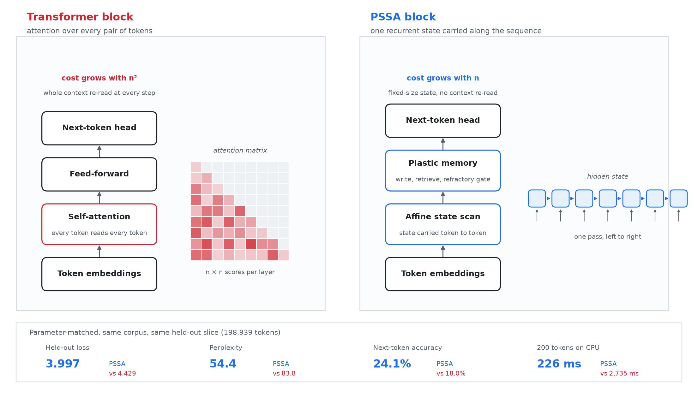
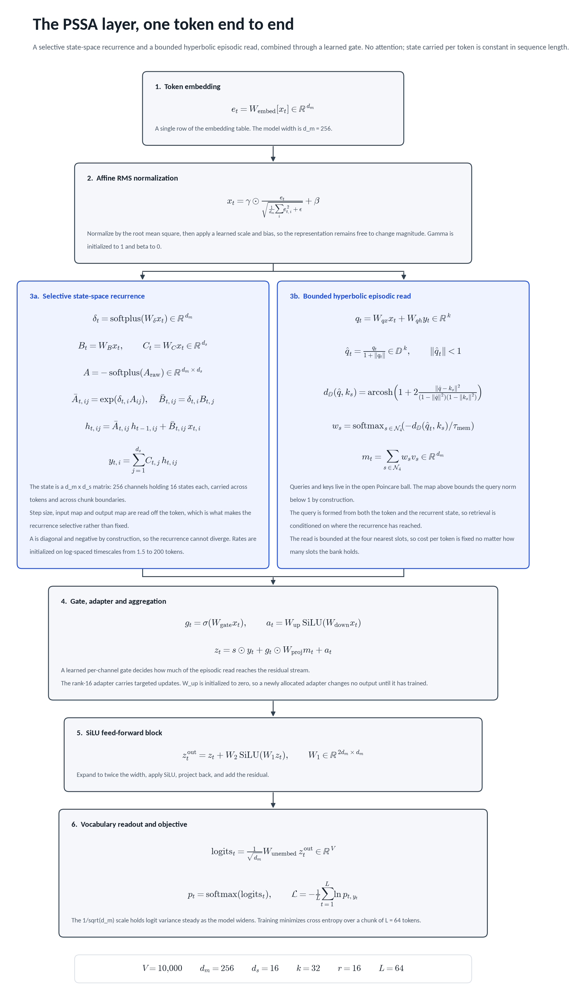
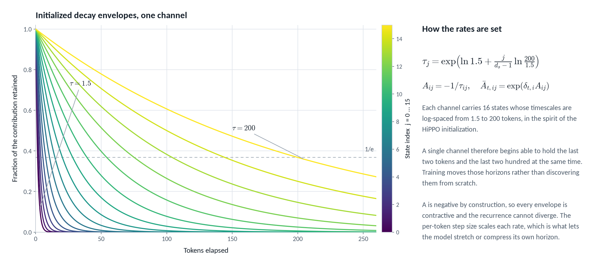
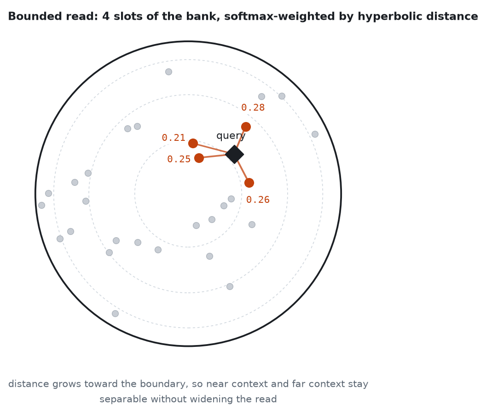

# Architecture

PSSA is a small language model that is not a transformer. It reads text one
token at a time through a recurrent state-space layer, keeps a bank of episodic
memories it can look things up in, and rewrites part of its own weights while it
runs.

For install, training setup and the command reference, see
[setup.md](setup.md) and [cli.md](cli.md). For measured results, see
[benchmarks.md](benchmarks.md).

## Why Rust, and why that is not the point

Not for speed points, and not because the language makes the architecture
better. PSSA needed per-token weight updates, a memory bank written during the
forward pass, and a scalar reference path that every batched kernel could be
differentiated against. Expressing that inside an autograd framework meant
fighting the framework at every step, so the linear algebra is written
directly instead. That made the plastic parts straightforward and the
gradients checkable against a reference to around 3e-8. The architecture is
the claim here. The implementation language is a detail, and a Python port is
welcome.

## How it differs from a transformer



A transformer scores every pair of tokens in the context, so its cost per step
grows with the square of the sequence length and the whole context is re-read at
every step. PSSA carries one fixed-size state along the sequence in a single
left-to-right pass, and looks things up in a memory bank instead of re-reading
the context, so cost grows linearly with length.

## The model



Every token goes through one PSSA layer: a selective state-space recurrence,
a bounded read from an episodic memory bank in hyperbolic space, a learned gate
that decides how much of that read reaches the residual stream, and a SiLU MLP.
The defaults are `d_m = 256` channels, `d_s = 16` states per channel, and a
rank-16 adapter.

### The recurrence

Write `x` for the layer-normalized token embedding. Three projections are read
off the token itself, which is what makes the recurrence selective rather than
fixed:

```
delta = softplus(W_delta x)      per-channel step size,  delta in R^d_m
B     = W_B x                    input map,              B in R^d_s
C     = W_C x                    output map,             C in R^d_s
```

The transition is diagonal, one rate per (channel, state) pair, kept negative by
construction so the recurrence cannot blow up:

```
A = -softplus(A_raw)             A in R^(d_m x d_s)
```

Discretizing that continuous system with step `delta` gives the per-token update.
`h` carries across tokens and across chunk boundaries during training:

```
Abar_ij = exp(delta_i * A_ij)
Bbar_ij = delta_i * B_j

h_ij <- Abar_ij * h_ij + Bbar_ij * x_i
y_i   = sum_j C_j * h_ij
```

`A_raw` is initialized so each channel's 16 rates sit on log-spaced timescales
`tau` from 1.5 to 200 tokens, in the spirit of the HiPPO initialization. A single
channel therefore starts out holding the last two tokens and the last two hundred
at the same time, and training moves those horizons rather than discovering them
from scratch.



This half of the layer is a selective diagonal SSM and claims no novelty; it is
the same family as S4 and Mamba, written out scalar-first so the backward pass
can be checked term by term.

### The memory read

The part that is specific to PSSA is what happens to `y`. A query is formed from
both the current token and the current state, so retrieval is conditioned on
where the recurrence has got to and not only on the token in hand:

```
q  = W_qx x + W_qh y
qh = proj(q)                     diffeomorphic map into the Poincare ball, |qh| < 1
```

By default the read scans all occupied slots, weighted by a softmax over
hyperbolic distance at temperature `tau_mem`. The opt-in CPU `--memory-top-k K`
prototype instead normalizes over the K nearest slots after scanning all keys:

```
w = softmax(-d_H(qh, k_s) / tau_mem)   over occupied slots (or selected top-k)
m = sum_k w_k * v_k
```



Hyperbolic distance grows toward the boundary of the ball, so slots holding
general context and slots holding one specific episode stay separable without
widening each key. Exact top-k reduces value mixing, not the linear key scan;
it is not constant-cost retrieval as the occupied bank grows.

### Gate, adapter, MLP

The read does not join the stream unconditionally. A learned per-channel gate
decides how much of it lands, alongside a low-rank SiLU adapter that carries
targeted updates:

```
g     = sigmoid(W_gate x)
z     = s * y + g (elementwise) W_proj m + adapter(x)
u     = W_2 silu(W_1 z)
z_out = z + u
```

### The write path

Writes are the reason the architecture is called plastic. A slot is inserted when
the incoming state is novel against what the bank already holds, each slot carries
a refractory counter that rate-limits how often it can be overwritten, and fast
plastic updates are folded back into the base transition matrix by a closed-form
ridge regression rather than living in the external store forever:

```
A_base <- A_base + (H^T H + lambda I)^-1 H^T dH
```

The refractory counter is what keeps a stream of contradictory updates from
erasing a slot that repeated evidence has already stabilized, and consolidation is
what stops the bank from being the only place long-range structure is stored.

### What is and is not new here

The recurrence is standard selective-SSM machinery. The claims are the hyperbolic
bounded read conditioned on the recurrent state, the novelty and refractory rules
on writes, and the ridge consolidation step from fast weights into the transition
matrix. Everything is implemented against a scalar reference path that the batched
and parallel implementations are differentiated against on every commit, currently
agreeing to a maximum gradient error around 3e-8 (`cargo run --release --example
twin_check`).

## Training pipeline

The `train` command performs two phases:

1. **Continuous recurrent ingestion:** token transitions are processed through the PSSA layer. The model updates state, memory, adapters, and routing behavior with a cosine learning-rate schedule.
2. **Adapter consolidation:** after each epoch, the plastic adapter's fast coefficients are folded into its consolidated coefficients with the configured EMA rate.

Defaults are latent 256, recurrent state 16, memory-key 32, memory capacity 512, chunk length 64, learning rate 1e-3, 8 chunks per update, and seed 42. The resulting binary holds weights, configuration, memory, adapters, and optimizer state. It is not an interchange format for other ML frameworks and should be loaded through `PSSALayer::import_from_pssa_bytes`.

## Depth and loops

Stacked PSSA blocks (`--depth`) and shared repeated passes (`--loops`) are
available from the normal `train` command. The operational details, parameter
accounting and CPU-only limits of stacked depth are in
[STACKED-DEPTH.md](STACKED-DEPTH.md). Batching independent documents through
shared matrix operations is described in [BATCHING.md](BATCHING.md).

## Math reference

The equations above, with their source locations, are also collected in
[../assets/math.md](../assets/math.md). The dashboard's `F11` math tab renders
the same reference.
