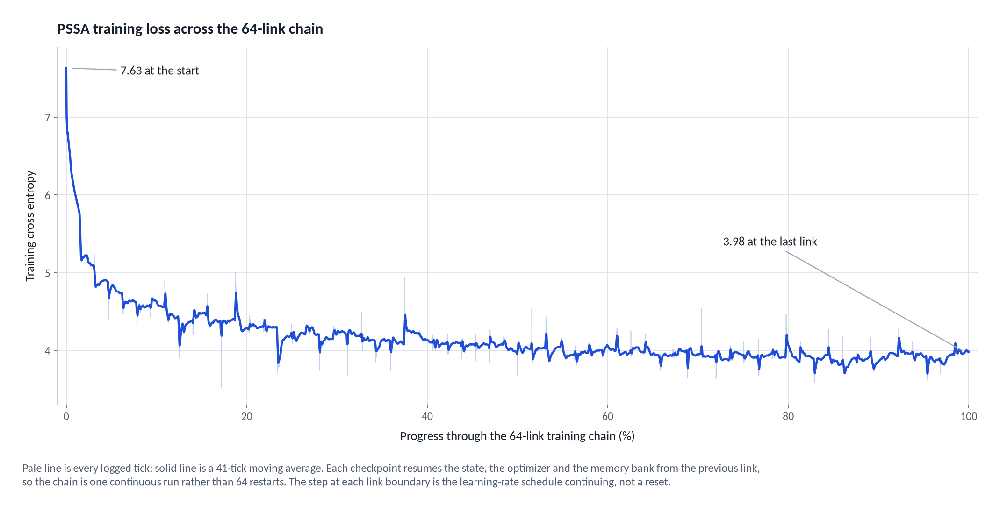
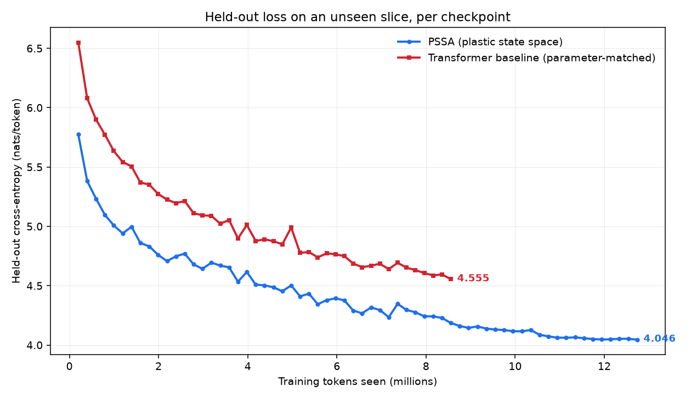
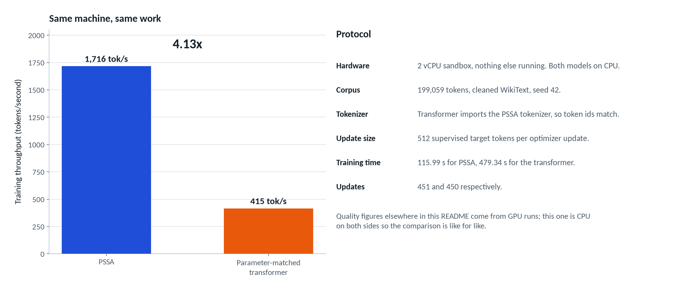
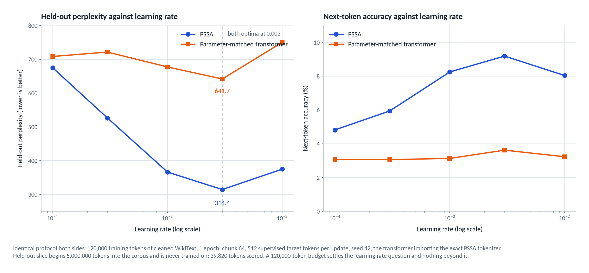

# Benchmarks and comparisons

This page collects the headline comparison, the matched-run methodology, the
benchmark commands, and the caveats that belong with these numbers. Detailed
reports live in their own files and are linked rather than duplicated.

Unless stated otherwise, losses are end-of-link training cross-entropy on the
stream being fit, not held-out evaluation.

## Headline result

Two models, same corpus, same tokenizer, same optimizer schedule, same seed,
same number of parameters. One is PSSA, one is a standard transformer. Over
12.7M tokens of cleaned WikiText-103:


PSSA finished at **3.98** training cross-entropy, the transformer at **4.43**.
That is a gap of **0.45 nats**, perplexity 53.7 against 83.7. The transformer
spent its entire 12.7M-token budget to reach a loss PSSA had already passed
around 2M tokens in.

The two curves never cross, and they never touch. Here is the PSSA run on its
own, every logged update across the chain:



29,243 logged updates, 7.63 down to 3.98, with a 41-point moving average drawn
over the raw ticks.

### It holds on text neither model has seen

Training loss only says a model fit the stream it was fed. So both checkpoints
were scored on a 198,939-token slice cut from a part of the corpus neither run
ever touched:



Every checkpoint of both runs, 64 PSSA links and 43 transformer links, scored on
a bounded 9,934-token window of that unseen slice. The curves never cross: PSSA
is ahead from the first link and finishes 0.51 nats lower. The table below is the
final checkpoint of each run on the full slice.

| Held-out slice, 198,939 unseen tokens | PSSA | Transformer |
| --- | --- | --- |
| Cross-entropy | **3.997** | 4.429 |
| Perplexity | **54.4** | 83.8 |
| Next-token accuracy | **24.1%** | 18.0% |

The held-out gap, 0.43 nats, is essentially the training gap. PSSA is not
memorizing harder, it is generalizing better.

### And it is much faster to run



Fixed work on the same 2 vCPU machine, 199,059 tokens at 512 tokens per update:
1,716 tokens per second against 415, so 4.13x. Both models were timed on CPU.



Both architectures put their optimum at the same learning rate, 0.003, so
neither run is winning on a tuning advantage. The sweep is a short probe on a
120,000-token slice, a settings check rather than a final number.

Generating 200 tokens on the same CPU, same prompt, same sampler:

| | PSSA | Transformer |
| --- | --- | --- |
| 200 tokens | **226 ms** | 2,735 ms |
| Relative | **12x faster** | baseline |

A recurrent model carries a fixed-size state, so the cost of each new token does
not grow with the length of what came before. A transformer re-reads its whole
context every step.

## What these numbers are, and are not

Being straight about the scale, because the numbers above are easy to over-read:

- These are **1.5M-parameter models** on 12.7M tokens. That is a research
  prototype, not a competitor to anything you have heard of.
- Text quality at this scale is poor for both models. PSSA emits "a barget of
  the Prian Academy", the transformer "a material circulation of the United
  States". The comparison is about learning efficiency, not fluency.
- The speed comparison is CPU-to-CPU, which is fair. The training throughput
  numbers below are **not** hardware-matched and should not be read as an
  architecture result.
- Two experiments are still unmeasured: retention of earlier skills after a
  corpus switch, and whether ablating the memory bank changes the loss.
- Losses here are end-of-link training cross-entropy on the stream being fit,
  not held-out evaluation, unless a table says otherwise. For a held-out
  comparison on an unseen slice, use the `compare` command described in
  [COMPARISON.md](COMPARISON.md).

## How the comparison was run

### How the two runs were matched

Both chains ran 64 links of 200,000 encoded tokens, each link resuming from the
previous checkpoint, so the learning-rate schedule and optimizer state continue
across the whole run instead of restarting per link.

- Identical corpus: one `clean-wikitext` pass over WikiText-103, reused byte for byte.
- Identical token IDs: the baseline pins `--tokenizer-from` to the PSSA chain's
  own checkpoint, so neither model sees a different vocabulary.
- Identical optimization: 30,000-update cosine horizon, no warm-up restart, 512
  supervised target tokens per update, seed 42.
- PSSA: latent 256, recurrent state 16, 512 memory slots, key width 32, vocab 2,048.
- Baseline: 1,541,120 parameters, 1 layer, width 256, 4 heads, FFN 448, vocab 2,048.

Matching the optimizer schedule cuts one way and not the other: neither model
received tuning the other did not, but a schedule that suits PSSA is not
guaranteed to be the transformer's best, so part of the gap could be an
undertrained baseline rather than the architecture. A per-model learning-rate
sweep is running now, both models swept over the same grid on the same token
budget, and the best-against-best numbers will be posted here when it
finishes, whichever way they come out.

### Per-token learning curve

End-of-link training cross-entropy:

| Link | Tokens seen | PSSA | Transformer |
| --- | --- | --- | --- |
| ck01 | 200,000 | 5.733 | 6.461 |
| ck05 | 1,000,000 | 4.617 | 5.467 |
| ck10 | 2,000,000 | 4.447 | 5.082 |
| ck15 | 3,000,000 | 4.292 | 4.858 |
| ck20 | 4,000,000 | 4.185 | 4.704 |
| ck25 | 5,000,000 | 4.221 | 4.704 |
| ck30 | 6,000,000 | 4.070 | 4.561 |
| ck35 | 7,000,000 | 4.039 | 4.523 |
| ck37 | 7,400,000 | 3.960 | 4.465 |
| ck44 | 8,800,000 | 4.004 | 4.480 |
| ck48 | 9,600,000 | 3.937 | 4.415 |
| ck52 | 10,400,000 | 3.846 | 4.344 |
| ck56 | 11,200,000 | 3.887 | 4.375 |
| ck60 | 12,000,000 | 3.972 | 4.418 |
| ck64 | 12,800,000 | 3.982 | 4.428 |

The baseline's first session was cut at link 43 by the notebook session limit
and its loss CSV did not survive, so links 1 to 43 are read back from that
session's own run log instead. The chain resumed from `ck43` in a second session
and finished all 64 links, and both curves above now cover the full run.

### Throughput is not hardware-matched

The headline training rates come from different machines and say nothing on
their own: PSSA trained on a Kaggle T4 at roughly 900 tokens/second, while the
baseline is CPU-only because `train-transformer` has no GPU path, and held 212
tokens/second there.
For a comparison that means something, both models were trained on the same
CPU-only box, a 2-vCPU container with no GPU, over the same 199,059-token
slice of the cleaned corpus with seed 42 and identical update counts. PSSA
held 1,716 tokens/second against the baseline's 415, so 4.1x on matched
hardware and matched work. An earlier measurement on Kaggle's CPU, before the
scan parallelization, put the same pair at 375 against 212.
The loss comparison above is unaffected either way, since it is matched on
tokens and updates rather than on time.

### Reproducing

```bash
bash kaggle/kaggle_continue.sh              # the PSSA chain
bash kaggle/kaggle_transformer_baseline.sh  # the parameter-matched baseline
```

Both read `TOTAL`, `WINDOW` and `FRESH` from the environment and write
`--loss-csv`, so the curve survives a cut session.

## Benchmark and comparison commands

`pssa benchmark` is an end-to-end smoke test or feature benchmark:

```bash
cargo run --release -- benchmark
```

The suite exercises synthetic streams for contradictory facts, MQAR-style
distractors, burst repetition, model serialization, and short generation
prompts. It prints milestone results, is not wired into Cargo's test harness,
and is not a quality evaluation on general language tasks.

`pssa compare` replays an existing PSSA chain with a token/update-matched
transformer and scores both on held-out tokens. The full workflow, including
chain provenance limits, loss CSV logging and standalone evaluation, is in
[COMPARISON.md](COMPARISON.md). The TUI also exposes a one-key matched
benchmark; see [TUI-EXTRAS.md](TUI-EXTRAS.md).

## Detailed write-ups

- [COMPARISON.md](COMPARISON.md) — replaying the Kaggle chain against the
  transformer, checkpoint provenance limits, curve logging, and held-out
  evaluation without training.
- [TRANSFORMER-BASELINE.md](TRANSFORMER-BASELINE.md) — the parameter-matched
  decoder-only baseline: architecture, size accounting, what is held constant,
  reproducible windows, and limitations.
- [GPU-CLIP-SPEED.md](GPU-CLIP-SPEED.md) — gradient-clipping and memory-value-cap
  validation, bounded CPU timing, and unverified GPU behavior.
- [PAIRED-EVAL.md](PAIRED-EVAL.md) — the opt-in paired multi-seed evaluation
  harness and its statistics.
- [BATCHING.md](BATCHING.md) — independent-sequence batching and its fixed-work
  throughput measurement.
- [STACKED-DEPTH.md](STACKED-DEPTH.md) — depth-four pilot and parameter
  accounting; a smoke test, not a language-quality claim.

Architecture details behind these numbers are in
[architecture.md](architecture.md).
