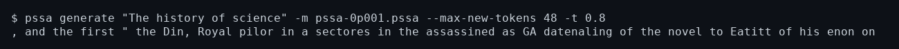

# CLI reference

Everything the dashboard does is also a plain CLI command, so it works the same
over SSH, in a notebook terminal, or in a script. `pssa help` prints every
command and flag.

For data sources, caches, long-corpus chains and checkpoint formats, see
[setup.md](setup.md). For benchmark and comparison commands, see
[benchmarks.md](benchmarks.md). For the dashboard, see [tui.md](tui.md).

## Common invocations

```bash
# train a fresh checkpoint on a local file (GPU)
pssa train data/corpus.txt -o chain/ck001.pssa --backend cuda --token-cache data/corpus.txt.tok

# continue the chain on the next slice of the corpus
pssa train data/corpus.txt --resume chain/ck001.pssa -o chain/ck002.pssa --backend cuda

# stream a Hugging Face dataset instead of a local file
pssa train --hf-dataset OWNER/NAME -o chain/ck001.pssa --backend cuda

# generate text
pssa generate "The history of science" -m chain/ck002.pssa --max-new-tokens 64 -t 0.8

# chat, score on held-out text, and list what is in this directory
pssa chat
pssa score
pssa status
```



## Commands

General form:

```text
pssa <COMMAND> [OPTIONS]
```

| Command | Purpose |
| --- | --- |
| `train [source]` | Fit a PSSA checkpoint on a text corpus and write a `.pssa` file. |
| `train-transformer [source]` | Fit the CPU decoder-only baseline and write a `.trfm` file. |
| `generate <prompt>` / `generate-transformer` | Continue a prompt with a trained checkpoint. |
| `chat [source]` | Interactive prompt loop against a checkpoint. `repl` remains a hidden alias. |
| `score [source]` / `score-transformer` | Score a checkpoint on held-out text as JSON. `evaluate` remains a hidden alias. |
| `throughput [source]` | Measure frozen-model scoring tokens/sec. |
| `status` | Checkpoints and corpora in the working directory. Takes no options. |
| `download <repo>` | Pull a Hugging Face dataset to a local file. |
| `clean-wikitext INPUT -o OUTPUT` | Stream-clean a raw WikiText file into a new UTF-8 corpus. |
| `benchmark` | End-to-end smoke test or feature benchmark. |
| `compare` | Replay an existing PSSA chain with a token/update-matched transformer and score both on held-out tokens. |
| `world-model` | Run the CPU-only boxes-world recurrent experiment. |
| `tui` | Open the dashboard and local checkpoint chat, or view piped training output. |
| `gpu-probe` | Check whether a WebGPU compute device is usable. |
| `help` | Print command and option help, including examples. |

The `world-model` experiment is described in
[experiments.md](experiments.md#boxes-world-recurrent-model-experiment). The
`benchmark` and `compare` commands are described in
[benchmarks.md](benchmarks.md).

## Options

| Option | Default | Applies to | Description |
| --- | --- | --- | --- |
| `-d, --data <source>` | `data/downloaded.txt` when present, otherwise `science` | `train`, `train-transformer`, `chat`, `score`, `score-transformer`, `throughput` | Dataset source, or a comma-separated list. |
| `-m, --model <path>` | `data/model.pssa` (or `.trfm` for baseline commands) | `chat`, `generate`, `generate-transformer`, `score`, `score-transformer`, `throughput` | Checkpoint to load. |
| `-o, --out <path>` | Command-specific; required for `clean-wikitext` | `train`, `train-transformer`, `download`, `clean-wikitext`, `benchmark` | Output checkpoint, dataset, or benchmark path. Cleaning requires a new file. |
| `-p, --prompt <text>` | empty | `generate`, `generate-transformer` | Prompt text. Required for generation. |
| `-e, --epochs <n>` | `4` | `train`, `train-transformer` | Training epochs. |
| `-t, --temp, --temperature <float>` | `0.70` | `chat`, `generate`, `generate-transformer` | Sampling temperature. |
| `--max-new-tokens <n>` | `64` (maximum 100,000) | `generate`, `generate-transformer` | Generation length cap. |
| `--latent <n>` | `256` | `train` | PSSA latent dimension. |
| `--depth <n>` | `1` | `train` | Continuous PSSA blocks; stacked models run on CPU. |
| `--state <n>` | `16` | `train` | PSSA recurrent state dimension. |
| `--key <n>` | `32` | `train` | PSSA memory-key dimension. |
| `--memory <n>` | `512` | `train` | PSSA memory-bank capacity. |
| `--batch-size <n>` | `1` | `train` | Independent PSSA document lanes. |
| `--chunk <n>` | `64` | `train`, `train-transformer` | Sequence chunk length. |
| `--lr <float>` | `1e-3` | `train`, `train-transformer` | Base learning rate. |
| `--accumulate <n>` | `8` | `train`, `train-transformer` | Chunks per optimizer update. |
| `--grad-clip <max_norm>` | off | `train` | Opt-in global L2 gradient limit across all Adam parameters; finite positive f32. |
| `--memory-value-cap <c>` | off | `train` | Opt-in L2 limit per episodic-memory value on load and every write; finite positive f32. |
| `--warmup-steps <n>` | `0` | `train`, `train-transformer` | Linear warm-up before cosine decay. |
| `--total-updates <n>` | unset | `train`, `train-transformer` | Fixed whole-run schedule horizon. |
| `--seed <n>` | `42` | `train`, `train-transformer` | Initialization seed. |
| `--tokenizer <bpe\|word>` | `bpe` | `train`, `train-transformer` | Tokenizer family. |
| `--vocab-size <n>` | `2048` | `train`, `train-transformer` | BPE vocabulary maximum. |
| `--tokenizer-from <path>` | unset | `train-transformer` | Import the exact tokenizer from a PSSA checkpoint. |
| `--max-tokens <n>` | unset | `train`, `train-transformer` | Global cap across input documents, not per document; scoring commands use it for a held-out slice. |
| `--skip-tokens <n>` | `0` | `train`, `train-transformer` | Skip this many tokens before training starts; scoring commands use it for a held-out slice. |
| `--resume <path>` | unset | `train`, `train-transformer` | Continue from an existing checkpoint. |
| `--loss-csv <path>` / `--loss-every <n>` | unset / `10000` | `train`, `train-transformer` | Append target-token training curves at update boundaries. |
| `--tokens-seen <n>` | unset | `train`, `train-transformer` | Offset for a new loss CSV on resume. |
| `--no-tui` | off | `train`, `train-transformer` | Disable cursor updates and emit rate-limited plain progress lines. |
| `--hf-dataset <owner/name>` | unset | `train` | Train from a paged, disk-cached Hugging Face dataset instead of a local source. |
| `--hf-config <config>` | auto | `train` | Dataset configuration; required when the repository has multiple configurations. |
| `--hf-split <split>` / `--hf-field <field>` | `train` / `text` | `train` | Split and text column (dotted nested fields supported). |
| `--skip-tokens <n>` / `--max-tokens <n>` | `0` / unset | `score`, `score-transformer`, `throughput` | Select a strict held-out slice; scoring never wraps at EOF. |

Positional arguments and long/short options can be mixed:

```bash
cargo run --release -- train data/downloaded.txt -e 2 -o data/experiment.pssa
cargo run --release -- train --data data/downloaded.txt --epochs 2 --out data/experiment.pssa
```

## Plain logs and pipes

The training display uses cursor updates only on a real terminal. For a plain,
parseable log (recommended for Kaggle or a pipe), pass `--no-tui`; the output
still includes loss, a short moving average, speed, ETA, update counts, learning
rate, memory occupancy, and checkpoint events. To view a piped log
interactively:

```bash
pssa train data/downloaded.txt -o chain/ck01.pssa --max-tokens 200000 -e 1 --no-tui \\
  | pssa tui --chain chain
```

## Chat commands

Inside the REPL:

- `/exit` or `quit` exits the process.
- `/info` prints the loaded model path, total memory slot count, and adapter count.
- `/temp <value>` changes the sampling temperature for later turns; it must be finite and at least zero.

The TUI inference chat has additional commands and a command palette; see
[tui.md](tui.md).

## Generation defaults

Generation is autoregressive and uses temperature 0.70, a top-24 candidate limit
followed by top-p 0.85 filtering, a 1.25 repetition penalty over a recent 64-token
window, immediate self-transition suppression, `<unk>` suppression, and a
default cap of 64 new tokens, ending early after two generated periods.

V7 BPE inference restores the exact embedded tokenizer and never rebuilds it from
a selected dataset. See [setup.md](setup.md) for checkpoint compatibility.
