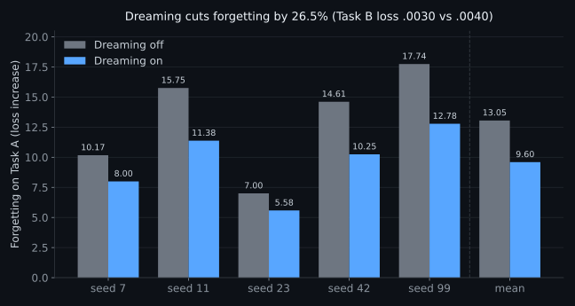

# Experiments and opt-in features

These are optional training features and research directions. They are off by
default, do not change the normal training path when disabled, and are documented
here so the main [README](../README.md) stays short. For install and dataset
setup see [setup.md](setup.md); for the command reference see [cli.md](cli.md).

Related write-ups:

- [BATCHING.md](BATCHING.md) — independent-sequence batching.
- [STACKED-DEPTH.md](STACKED-DEPTH.md) — stacked-depth PSSA and loops.
- [GPU-CLIP-SPEED.md](GPU-CLIP-SPEED.md) — gradient clipping and the
  memory-value cap.
- [PAIRED-EVAL.md](PAIRED-EVAL.md) — the paired multi-seed evaluation harness.

## Training loss safety

Finite-loss blow-up guard (enabled by default).

PSSA training checks each target-token-weighted optimizer-group loss before
Adam. It aborts without writing or replacing a checkpoint after three consecutive
suspect groups: loss above `4 * ln(vocab)` or above `8 *` the healthy running
loss (EWMA, alpha 1/8). The reference freezes during suspect streaks so a jump
followed by a high plateau cannot hide itself. Isolated spikes recover. This is
not a held-out validation monitor; a resumed run starts a fresh loss history.

```sh
pssa train corpus.txt --loss-guard-high-factor 4 --loss-guard-jump-factor 8 --loss-guard-patience 3
```

Factors must be finite and greater than one; patience is a positive update-group
count. Controls are runtime-only; repeat custom values on resume. The TUI wizard
exposes all three settings and the monitor shows the configured guard and halt
reason. Existing non-finite tensor checks remain in force.

For the opt-in `--grad-clip` and `--memory-value-cap` flags, and the validation
behind them, see [GPU-CLIP-SPEED.md](GPU-CLIP-SPEED.md).

## Memory capacity experiments

Resume growth and opt-in CPU nearest-slot reads.

Full soft reads remain the default; the existing write/overwrite gate is unchanged.
`--memory N` chooses fresh-run capacity. A resume still rejects a mismatched
`--memory`; use the explicit `--grow-memory N` instead (equal or larger only).
Growth preserves occupied slots, confidence, timestamps, eviction order, parameters,
Adam moments and recurrent state. The next checkpoint uses the existing format
with larger arrays; no migration or new checkpoint version is involved.

```sh
pssa train corpus.txt --resume old.pssa --grow-memory 4096 -o grown.pssa --backend cpu
pssa train corpus.txt --memory 1024 --memory-top-k 4 --backend cpu -o sparse.pssa
pssa score heldout.txt --model sparse.pssa --memory-top-k 4
```

`--memory-top-k K` is an **experimental exact nearest-slot read**, not an ANN
index: it still scans every occupied key, selects K by hyperbolic distance,
renormalizes soft weights on those slots, and mixes only their values. Selection
is piecewise constant in backward; gradients flow through selected weights.
Training requires explicit `--backend cpu`; GPU kernels are unchanged. K at least
the occupied count takes the original full-read path. It may be slower, especially
on small banks; do not assume a speed or accuracy improvement.

Retrieval mode is runtime-only: repeat it on resume and `score`. Other checkpoint
consumers (including automatic TUI evaluation/chat) use the default full read.
The TUI **Setup → model** page exposes capacity, resume growth and CPU top-k;
the monitor reports retrieval/growth events without treating them as losses.
For a reproducible short capacity/CE/RSS sweep, see `experiments/memory_sweep.py`.

## Dreaming

Dreaming is an optional sleep phase between training updates. The model replays
some stored memories, and it can also generate short rehearsal sequences, so
useful patterns are revisited instead of being left behind by the newest batch.
It is off by default and does not alter the normal training path when disabled.

The CLI controls are:

- `--dream-every N` — run a dream every `N` optimizer updates; `0` disables it.
- `--dream-replay K` — replay up to `K` occupied memory entries per dream
  (default `32`).
- `--dream-mode memory|generate|both` — choose memory replay, generated
  rehearsal, or both (default `memory`).
- `--dream-len N` — generated rehearsal length (default `64`).
- `--dream-lr F` — rehearsal learning rate (default `0.006`).
- `--dream-steps N` — rehearsal passes per sequence (default `1`).

For example:

```bash
pssa train data/corpus.txt -o runs/dream.pssa --dream-every 100 \
  --dream-replay 32 --dream-mode both --dream-len 64 \
  --dream-lr 0.006 --dream-steps 1
```

In the TUI, open **Setup**, page through the training fields, and change
**Dream every updates (0 = off)** from `0`; the remaining dream fields use the
same names, defaults, and validation as the CLI. The equivalent command shown
by the wizard includes only dream flags that differ from their defaults. The
monitor reports when a dream is active, its count and mode, and the last dream
loss separately from the ordinary training loss.

On the measured five-seed probe (7, 11, 23, 42, 99), mean forgetting fell from
`13.0549` with dreaming off to `9.5961` with dreaming on in `both` mode, a
`26.5%` reduction. Task B's final loss fell from `0.0040` to `0.0030`.



## Boxes-world recurrent model experiment

Opt-in RSSM-style PSSA versus plain autoregressive PSSA (CPU only).

```sh
pssa world-model
pssa world-model --seed 73 --train-episodes 32 --heldout-episodes 12 --epochs 3
pssa world-model --help
pssa world-model | pssa tui
```

This bounded **non-bio research mode** trains a continuous PSSA recurrent backbone
on a tiny fully observed box-pushing grid. A categorical posterior observes real
frames; a learned prior predicts latents from history and actions. Training uses
reconstruction, KL, reward and continuation objectives with straight-through
categorical gradients. Imagination sees only the initial frame and subsequent
actions. Learned recurrence is backpropagated across each episode, not frozen.

The command compares against a plain autoregressive PSSA control using the same
episodes, update count and recurrent widths. It reports before/after held-out
next-frame NLL, open-loop NLL, field/exact accuracy, reward/continuation Brier,
parameter counts and training time. **NLL is nats per grid field, not text CE.**
Targets are scored before assimilation, held-out seeds are disjoint, and evaluation
carries reset. This comparison is **not parameter- or time-matched**. The short
three-seed example (`cargo run --profile fast --example boxes_world`) found lower
next-frame NLL with the plain control in all three seeds; stochastic training was
about 4.5× slower. Neither model solved the task at this budget.

All settings are listed in `--help`: grid size, recurrent widths, categorical
size, training/held-out episodes, episode/open-loop horizons, epochs, seed,
learning rate, KL/auxiliary weights and gradient clipping. Individual ranges and
a combined work cap reject oversized requests before allocation. Defaults finish
quickly; quadratic episode backpropagation is a correctness reference, not a
scalable training engine. No external corpus, GPU selection or checkpoint I/O is
supported; `train`, `score`, checkpoint formats and GPU kernels are unchanged.
The experiment makes no memory writes or adapter consolidation.

In **TUI → Setup → Source**, cycle to **boxes-world**. The four wizard pages show
only its relevant settings; the review button launches `world-model` and saves
`train.log` in a fresh output directory. No checkpoint is promised or written.
The monitor keeps separate measured braille-dot objective traces and held-out
results; it never inserts these values into language-loss charts. Text-training
drafts are preserved when switching back. Existing loss-guard and memory settings
remain available in the ordinary training wizard.

This is RSSM-style, **not a full DreamerV3 agent**: one categorical variable, biased
straight-through gradients, no actor/critic, replay-based policy learning or
planning benchmark. The fully observed deterministic task does not establish a
need for stochastic latents. Diffusion is not added: iterative denoising has no
demonstrated benefit for these discrete symbolic frames. Existing `train
--dream-*` replay options are a separate mechanism, not this mode.

## Next steps

- Install, datasets and long-corpus chains: [setup.md](setup.md).
- Commands and options: [cli.md](cli.md).
- Dashboard controls for these features: [tui.md](tui.md).
- Results and methodology: [benchmarks.md](benchmarks.md).
