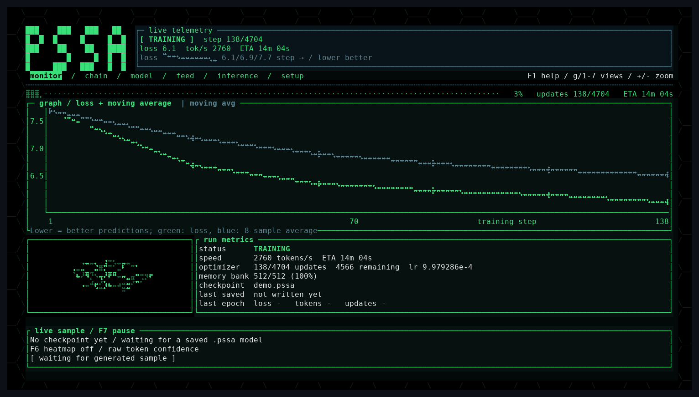
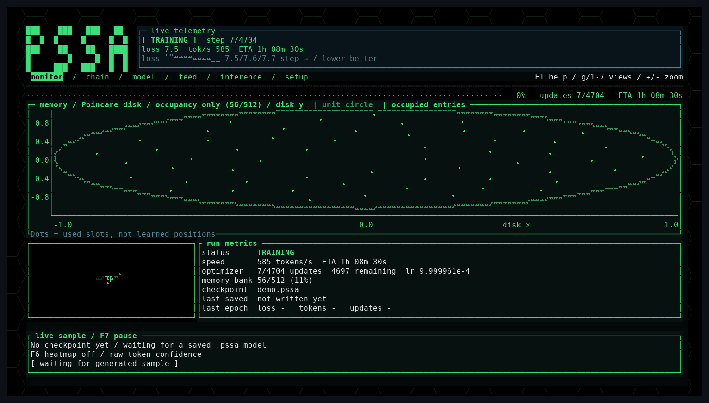
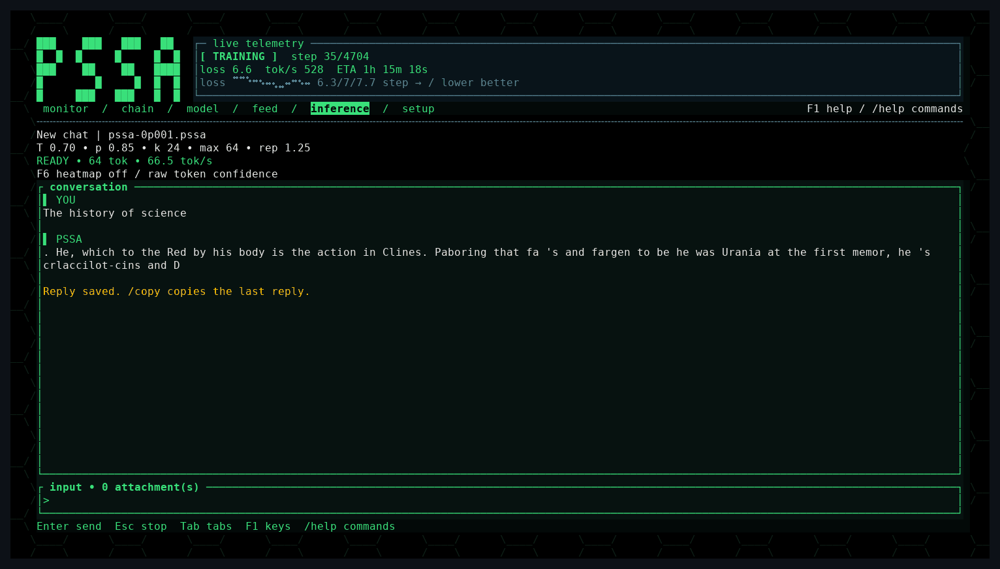
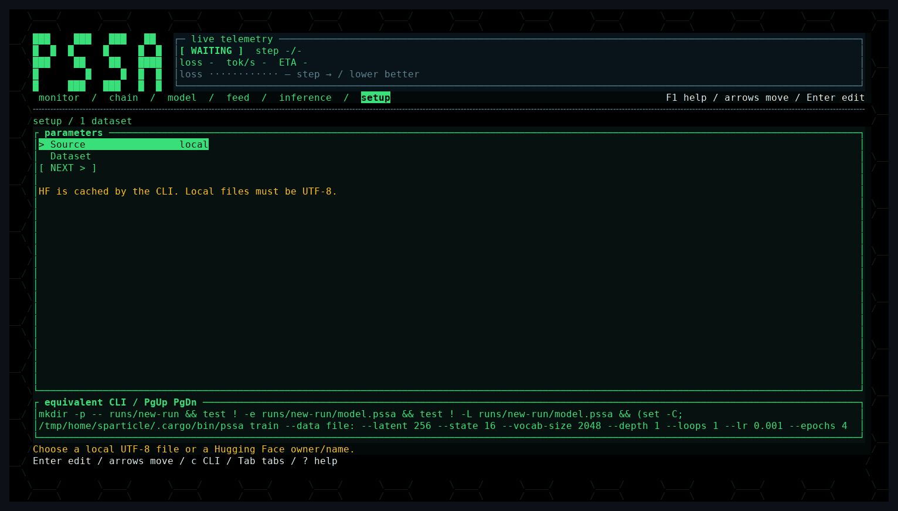
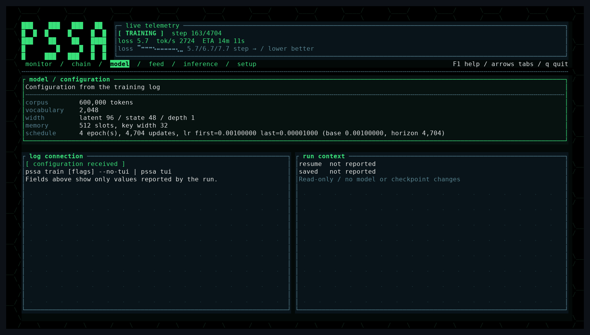
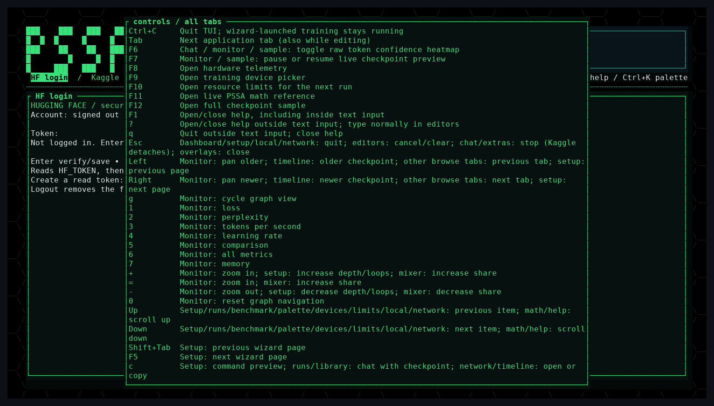

# Terminal dashboard

`pssa tui` is the main way to use the project: watch a training run, chat with a
checkpoint, set up a new run, and inspect the memory bank, all in one terminal.
Pipe a training run into it to watch it live:

```bash
pssa train data/corpus.txt -o chain/ck001.pssa --backend cuda --no-tui | pssa tui --chain chain
```

`Tab` cycles screens; `Ctrl+K` opens a searchable command palette. `?` opens
help outside text entry; `F1` opens help everywhere (question marks still work
in prompts/paths). `Ctrl+C` quits everywhere. Existing piped / `--no-tui` CLI
behavior is unchanged. Screens retain the CRT green style and compact /
narrow-terminal layouts.

For the training wizard in detail see [training-setup.md](training-setup.md).
For Kaggle, the plastic memory inspector, A/B inference and the one-key
benchmark see [TUI-EXTRAS.md](TUI-EXTRAS.md). For plain CLI commands see
[cli.md](cli.md).

## Monitor

Loss and its moving average, speed, ETA, optimizer progress, memory occupancy,
and a live sample from the newest checkpoint. Press `g` or `1`-`7` to switch the
graph (loss, perplexity, tokens/s, learning rate, comparison, all metrics,
memory) and `+`/`-` to zoom.



The memory graph (`7`) plots which episodic memory slots are in use on the
Poincare disk the model reads from.



## Inference

Chat with any checkpoint. `/model PATH` loads one, and `/temp`, `/top-p`,
`/top-k`, `/max-tokens` and `/repetition-penalty` change sampling. `/ab` puts
PSSA and the transformer baseline side by side, and `F6` colors each token by
the model's confidence.



## Setup

A step-by-step wizard for a new run (dataset, model size, depth and loops,
schedule, backend). It shows the exact equivalent CLI command at the bottom, so
you can copy it into a script. The dreaming controls live here too (see
[experiments.md](experiments.md#dreaming)).



## Model, chain and feed

The model tab shows the configuration the run reported. The chain tab lists
saved checkpoints with their loss, and the feed tab shows the text and token ids
being trained on when streaming from Hugging Face.



## Extras

`Ctrl+K` opens the command palette, which reaches Hugging Face login, Kaggle
launch and logs, the memory inspector, past runs and the matched benchmark.
`F8` shows hardware telemetry, `F9` picks the training device, `F10` sets
resource limits, and `F11` opens a live math reference for the layer.

`F1` shows every key at any time:



## Local inference chat (TUI)

Run `pssa tui` in a terminal (or run with no arguments on a TTY), then press
**Tab** to reach **inference**. Existing `chat`/`generate` CLI commands and
`--no-tui` logging are unchanged. Non-TTY `tui` output remains a plain log
passthrough.

- `/model` lists PSSA/TRFM checkpoints in `--chain DIR` and `data`; `/model PATH`
  selects one. Paths may contain spaces, without shell quotes. Checkpoints and
  their embedded tokenizers are loaded read-only in a worker, not the render loop.
- Type a message and press **Enter**. Tokens stream into the conversation with
  an actual token count and live average tokens/sec (including load/prefill time).
  **Esc** or `/stop` cancels; partial replies are retained. Checkpoint loading is
  not interruptible, but prefill/generation check cancellation between tokens.
- `/new`, `/chats`, `/open ID`, `/rename NAME`, `/delete ID` manage conversations.
  Repeat `/delete ID` to confirm. JSON documents in `chats/` contain the model
  path, messages, system prompt and settings; use `tui --chats-dir DIR` to change
  the location. Writes are atomic; files are owner-only on Unix. These local
  files include attachment contents—treat them as private. No chat is uploaded.
- `/temp 0.7`, `/top-p 0.85`, `/top-k 24`, `/max-tokens 64`, and
  `/repetition-penalty 1.25` change sampling controls; `/system TEXT` sets the
  system prompt (empty clears it). Max output is 1–4096 tokens. Context is a
  plain `System`/`User`/`Assistant` transcript, not an instruction-tuned chat
  template: the quality depends on the trained checkpoint. Overlong context
  (>256 KiB) is rejected rather than silently discarding history.
- `/attach PATH` inserts a UTF-8 text file into the **next** message (64 KiB total
  pending attachments); `/detach` clears them. Images, PDFs, audio, binaries and
  other non-text files display “not supported by this model yet”.
- **PgUp/PgDn** scroll through wrapped history; **End** follows the latest reply.
  `/copy` requests terminal clipboard access via OSC 52 (the terminal must permit
  it). `/help` lists chat commands; **F1** opens the shared keyboard help.
  **Ctrl+U** clears input; `//text` sends a leading slash. In inference, `q` and
  `?` are text and Esc stops, not quits; **Ctrl+C** quits, or Tab to another tab
  and use the existing `q` key. Outside text input, **?** also opens help.

The tab order is **monitor, chain, model, feed, inference, setup, HF login,
Kaggle, memory, runs, benchmark, sample, hardware, math, devices, limits,
library, mixer, eval, HF backup, cloud log, phone ping, updates, support,
GitHub, sweeps, timeline**. The [training setup wizard](training-setup.md)
launches a separate trainer and returns to the monitor; **Tab** switches tabs
even while editing a field. **Ctrl+K** opens the command palette. All tabs share
one **F1 / ?** keyboard reference. At 80+ columns the tab strip pages between
the original six tabs, HF login/extras, the five run controls, library/mixer/eval,
and the network/community pages when the full strip will not fit; below 80
columns it shows the active tab. **F1** lists every keyboard control.

## Backups, cloud logs and community (TUI)

Use **Ctrl+K**, type a tab name, then **Enter**, or cycle with **Tab**.
**Up/Down** selects a field; **Enter** edits/applies it, **Esc** cancels,
and **Ctrl+U** clears an editor. These features run only while the TUI is open;
plain CLI training and non-TTY logging do not start network workers.

- **HF backup:** enter a checkpoint path and an **existing** `owner/repo`, then
  **p** pushes the checkpoint and a generated model card. Uses the **HF login**
  credentials; uploading needs a token with write access to that repository.
  Automatic backup counts new `saved_checkpoint=` events, defaulting to every
  **3** saves. Edit the interval (**0** disables), or press **d** to toggle.
  It does not upload checkpoints merely discovered in a historical scan or
  interpret a remote path as a local file. One bounded-memory worker uploads;
  while busy, only the newest due checkpoint is queued. Logged-out/offline
  attempts show a skip status; **r** retries manually. No repository is created.
  Uploads replace `model.pssa`/`model.trfm` and `README.md` on the repo's `main`
  branch (previous versions remain in HF history). Basic Git LFS transfer is
  supported up to 5 GiB; multipart transfers are refused with a status.
- **Cloud log:** **Enter** a streaming/append-only HTTPS URL or a local file
  synced from a notebook, then **p** follows it in its own live view. Checkpoint
  and throughput lines are highlighted. **PgUp/PgDn** scroll, **End** follows
  live output, **d** pauses, and **r** reconnects. Partial lines survive reconnects;
  disconnects retry with 1–30-second backoff. History is capped at 400 lines;
  large HTTP logs need Range support (otherwise use a synced file). URLs stay
  in memory and are masked because their query strings can contain credentials.
- **Phone ping:** **OFF by default**. Set mode to `ntfy` with an unguessable
  ntfy.sh topic, or `webhook` with an HTTPS URL; **d** explicitly enables/disables.
  Notifications contain only fixed checkpoint/finished/died summaries, never
  checkpoint paths, logs, prompts or credentials. Subscribe to the topic in
  the ntfy phone app; public topics are not private unless separately protected.
  Delivery runs in a bounded worker; the tab retains a bounded delivery log and
  failure count. **p** sends a test checkpoint event; **r** retries. Generic
  webhooks receive JSON with `event`, `message` and `source: "pssa"` fields.
- **Updates:** checks stable releases of `Sparticle62ops/pssa` at most once per
  24 hours, including failed attempts and manual **r** checks. A newer release
  shows a small monitor banner. **o** opens the release; **d** toggles checks.
  This never pulls git, downloads a binary, or builds automatically.
- **Support:** GitHub, Discord and issue links, plus the exact **SOL** address
  from [Donate](../README.md#donate). **Up/Down**, then **Enter** or **o** opens
  a link; **c** copies the wallet using an available desktop clipboard helper
  (`wl-copy`, `xclip`, `pbcopy` or `clip`). Without one, copy the displayed text.
- **GitHub:** public, read-only browsing of the first 50 open **p** PRs or **i**
  issues; **r** refreshes, **Up/Down/PgUp/PgDn/Home/End** selects, **o** or
  **Enter** opens the discussion. **l** opens masked token login; **Ctrl+L**
  signs out. Reads `GH_TOKEN`, then `GITHUB_TOKEN`, then
  `~/.cache/pssa/github/token`; entered tokens are verified and saved atomically
  with Unix mode **0600**, like HF login. Use a minimally scoped read token.
  No GitHub write endpoints, fork, push or PR-creation actions exist.
- **Sweeps:** configure the base run in **setup**, leave Resume empty, then edit
  comma-separated learning rates, latent sizes and batch lanes. Blank grids use
  the wizard values; **r** copies them, **p** queues the grid (up to 32 trials).
  Runs use the existing `train` command **one at a time**, waiting for other
  TUI-owned trainers/benchmarks. Each gets a fresh `sweep-…/trial-NNN` directory
  with `train.log` and `model.pssa`. Results show measured **training** loss and
  throughput, not held-out scores. **d** cancels pending trials, never the active
  child. Quitting leaves that child running but does not launch further trials.
- **Timeline:** a horizontal view of the current local run's saved checkpoints.
  **Left/Right** (or **Up/Down**) scrubs, **Home/End** jumps, **r** rescans.
  Recorded loss/throughput comes from bounded log reads; unavailable history
  remains `n/a`, not inferred from checkpoint weights. **c** chats with a selected
  checkpoint; **Enter** fills setup's Resume and a fresh output directory for
  review—it does **not** launch. Match the checkpoint's shape/chunk and dataset
  before starting. Sync remote checkpoints/logs locally to use this view.

Backup/notification/update settings live in
`$XDG_CONFIG_HOME/pssa/tui-network.json` (default
`~/.config/pssa/tui-network.json`, owner-only on Unix). For example,
`"updates": {"enabled": false}` disables release checks. Notification topics and
webhook URLs can be secrets: keep this file private. Set **`PSSA_OFFLINE=1`**
(or **`HF_HUB_OFFLINE=1`**) before launching the TUI to skip Phase 12c HTTP calls;
local log following, sweeps and the timeline still work. Explicitly enabled
uploads/notifications may already have reached their service when disabled or
when you quit; no background network service survives TUI exit. A piped TUI
waits at EOF only for opted-in pending uploads/notifications; **q** can leave
without waiting. With those features off, its normal immediate-EOF behavior
is unchanged.

## Live samples, hardware and run controls (TUI)

- **Sample (F12):** the monitor includes a compact live sample when there is room;
  the full sample tab works on narrow terminals. A changed saved PSSA checkpoint
  is sampled at most once a minute in a separate CPU process: one Rayon thread,
  low priority via `nice` when available, up to 32 tokens and a 20-second timeout.
  **F7** pauses/resumes it. Loading/generation never waits on the trainer or UI,
  and no checkpoint is modified. Before the first save, a placeholder is shown.
  Remote Kaggle checkpoints are not sampled; their paths are never loaded as
  local files. The preview does not create extra checkpoints: a single training invocation
  currently saves at completion, while resumed/chain runs expose earlier saves.
  Checkpoints over 128 MiB or insufficient available RAM are skipped to protect
  the run; Linux `prlimit`, when installed, also caps the worker's address space
  at 512 MiB. Failures retain the previous sample with an explanatory status.
- **Confidence heatmap (F6 in inference, monitor or sample):** generated text is
  colored red below 10%, amber from 10% to below 50%, and CRT green from 50%.
  The legend describes **raw model softmax probability**, including the unknown
  token, before temperature, top-k/top-p and repetition penalty—not confidence
  after sampling filters. The toggle does not affect generation. New saved chats
  retain scores; older chats show `n/a`. BPE tokens that share a decoded UTF-8
  character share their minimum probability color rather than splitting bytes.
- **Hardware (F8):** host-wide CPU usage/history, per-core bars when space permits,
  and RAM used/total come from Linux `/proc`. If `nvidia-smi` is available, the
  panel also shows GPU names, VRAM, utilization, temperature, power and driver.
  Sampling is asynchronous and throttled to two seconds; unsupported counters
  show `n/a`. Without NVIDIA telemetry, real WebGPU adapter names are shown with
  `n/a` counters; backend availability is in the devices screen.
- **Devices (F9):** **Up/Down**, then **Enter** selects an available backend for
  the next wizard run; **r** refreshes runtime discovery. The wizard's Backend
  field cycles the same available choices. CPU, automatic fallback, CUDA
  (requires a CUDA-enabled binary and driver), and real WebGPU adapters are
  distinguished; software adapters are excluded. Selection uses the existing
  `--backend` flag: CUDA visible device 0 or WebGPU's preferred adapter. Other
  adapters are informational, not a promise of per-index selection. Active jobs
  and chat are unchanged; unsupported accelerators are labelled explicitly.
- **Limits (F10):** edit threads, RAM MiB, maximum batch lanes and corpus tokens,
  then select **Apply**. **d** resets the draft; blank fields preserve defaults.
  These values also appear in setup and its equivalent CLI command. `--threads`
  creates a local Rayon pool; changing thread count may change the last few
  digits through reduction order. `--ram-mib` requires Linux `prlimit` and caps
  **virtual address space**, not RSS or VRAM; GPU mappings also count and a budget
  that is too low can abort the training child. Batch lanes and corpus tokens
  use the existing `--batch-size` and `--max-tokens` flags (not per-epoch tokens,
  a GPU memory quota, or chat generation limits). No limits change an active run.
- **Math (F11):** scroll with **Up/Down**, **PgUp/PgDn**, **Home/End** through the
  state recurrence, memory slots, refractory writes, plastic adapter, MLP,
  depth/loops and loss. Equations and source references live in
  [`assets/math.md`](../assets/math.md). Dimensions, reported parameter count,
  occupancy and learning rate follow the open run; unreported values stay `n/a`.
  Per-token dense MACs are an explicitly labelled forward-only estimate, not
  measured throughput or total training FLOPs.

For example, the optional CLI limits can also be used without the TUI:

```bash
pssa train science --backend cpu --threads 2 --ram-mib 2048 \
  --batch-size 1 --max-tokens 20000 --no-tui -o runs/limited.pssa
```

## Local models, datasets and evaluation (TUI)

- **Library:** **m** sets the models folder, **d** sets the datasets folder,
  **r** rescans, and **Up/Down** selects a file. Folder preferences and the eval
  prompt path are saved in `$XDG_CONFIG_HOME/pssa/tui.json` (otherwise
  `~/.config/pssa/tui.json`); unrelated config fields are preserved.
  Scans are non-recursive and run off-thread, listing `.pssa`/`.trfm` models
  and `.txt`/`.jsonl`/`.parquet` datasets with size and UTC modification date.
  Model dimensions are header hints, not a full validation or a weight load.
  **c** opens a checkpoint in chat; **u** fills Setup's Resume and cheap header
  shape hints. A `.trfm` resume uses the existing CPU `train-transformer`
  command; PSSA-only wizard fields do not apply. Review settings before launch.
- Selected datasets show record/line counts, approximate tokens, and sample
  lines. Stats use the existing **word tokenizer**, not a checkpoint's BPE;
  prefixes target 256 KiB / 2,048 records (at most one extra bounded record),
  with extrapolated totals explicitly labelled as estimates. Skewed files can bias these estimates.
  **Enter** refreshes the selected stats. **t** fills Setup's Dataset; JSONL
  and Parquet are converted off-thread into a new UTF-8 corpus first.
  JSONL accepts strings or `text`, `content`, or `body` string fields.
  Parquet uses the optional **local** `python3` + `pyarrow` adapter in
  [`scripts/tui_parquet.py`](../scripts/tui_parquet.py), embedded in the binary so
  installed builds need no source checkout. It uses the same column names and
  streams small batches; missing tools show an error. Nothing is downloaded.
  Records over 1 MiB are rejected with guidance.
- **Mixer:** **Up/Down** chooses a source; **+/-** changes its relative token
  share (zero disables it). The bars show weights, percentages show normalized
  shares, and per-source/total counts use the same word-token estimates.
  **Enter** writes `corpus.txt` plus `mix.json` under the datasets folder's
  `.pssa-mixes/` and fills Setup's Dataset when finished. Exports use deterministic
  weighted source prefixes without repetition, at most one million word tokens
  and 256 MiB. The manifest records actual counts, which may differ from
  sampled targets. Inputs are never overwritten. Mixing is opt-in; ordinary
  CLI/wizard training defaults are unchanged.
- **Eval:** automatically watches completed checkpoints, generating fixed greedy
  answers and teacher-forced reference-answer loss/perplexity in one separate,
  low-priority CPU process. It uses one thread, pauses between forwards, and
  has file/model/time limits (64 MiB checkpoint, 128 MiB model/tape allocation,
  120 seconds); unsupported, oversized or invalid checkpoints are recorded as
  skipped, not training errors. The trainer never waits for evaluation.
  Results append to `auto-eval.jsonl` beside checkpoints, keyed by checkpoint
  identity and prompt-suite hash. The chart shows reference NLL over checkpoint
  numbers; answer panes compare adjacent checkpoints. **Up/Down** selects a
  checkpoint, **PgUp/PgDn** a prompt, **a** pauses/resumes, **p** edits the prompt
  JSON path (empty restores the built-in suite), and **r** reloads it.
  Copy `assets/eval_prompts.json` as a starting point; `PSSA_EVAL_PROMPTS` also
  supplies a startup path when no persisted path is set. Scores are tokenizer-
  specific, not a correctness grade or directly comparable across tokenizers.
  PSSA evaluation uses checkpoint memory, fresh carry, and runtime loops=1.
  The TUI must remain open to continue watching/evaluating.
- **Memory:** **v** switches the shared tab between the saved-checkpoint inspector
  (**r** refreshes; **PgUp/PgDn** scroll) and live chat retrieval. While chat streams,
  the live view shows actual occupied-slot retrieval strengths
  from the latest PSSA token, ranked strength bars, and a bounded recent-token
  history. Query/input and predicted token are distinguished; stacked layers
  and the final loop pass are labelled. This is a read-only copy of existing
  inference state, not another retrieval or a synthetic animation. Transformer
  checkpoints report that they have no PSSA slots. No telemetry is saved to
  the checkpoint. Narrow terminals use compact/stacked layouts.

## Speech capture

Optional local speech capture (Linux/ALSA) is built with `cargo build --release
--features speech`. Install an existing local **whisper.cpp** `whisper-cli` (or
`main`) and **arecord**, then set `PSSA_WHISPER_BIN` and `PSSA_WHISPER_MODEL` to
the binary and ggml model paths. Without overrides the app searches PATH for
`whisper-cli`/`main` and `models/ggml-{base.en,base,tiny.en}.bin` for a local model.
`/speech` records ten seconds, transcribes locally, deletes temporary audio, and
inserts text in the input box for review; it never auto-sends. Esc cancels the
child process. Missing tools/model or a default build show enablement guidance.
No models are downloaded and the default build has **no audio dependencies**.

## Related documents

- [training-setup.md](training-setup.md) — the training wizard.
- [TUI-EXTRAS.md](TUI-EXTRAS.md) — Kaggle, memory inspector, A/B inference,
  runs browser, matched benchmark, alerts, GIF recording.
- [tui-demo.tape](tui-demo.tape) — the VHS recording tape for the dashboard GIF.
- [cli.md](cli.md) — the plain-command equivalent of every dashboard action.
